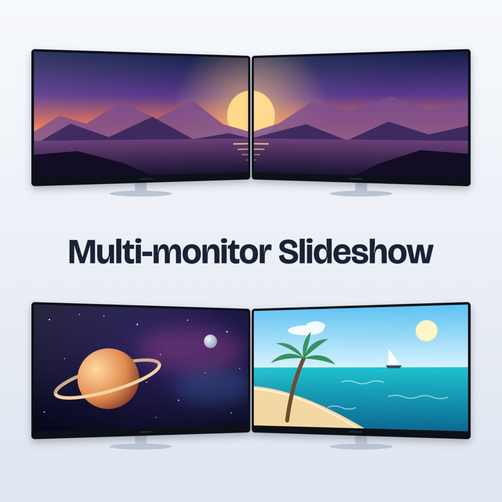
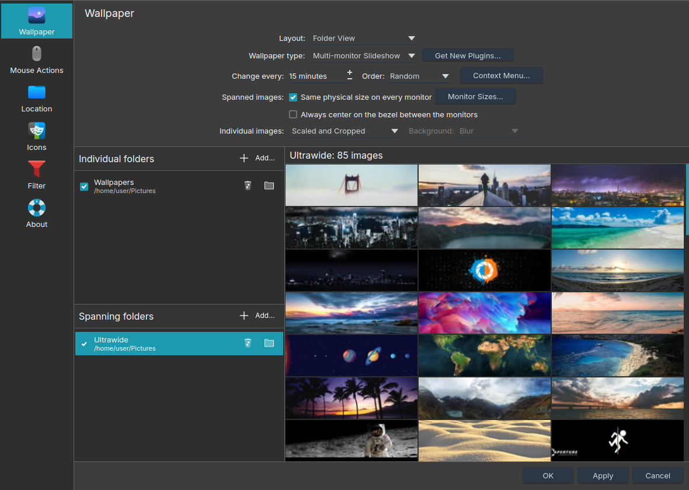
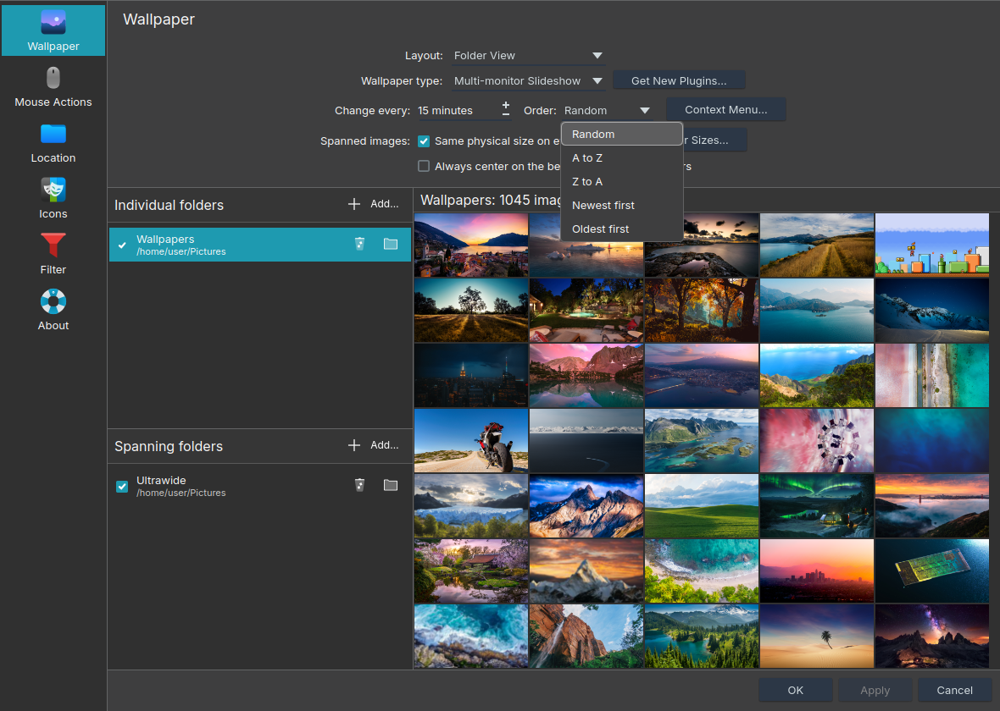
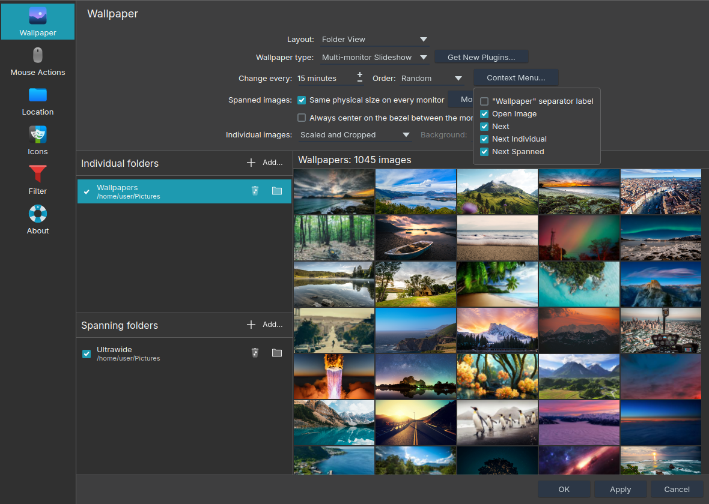
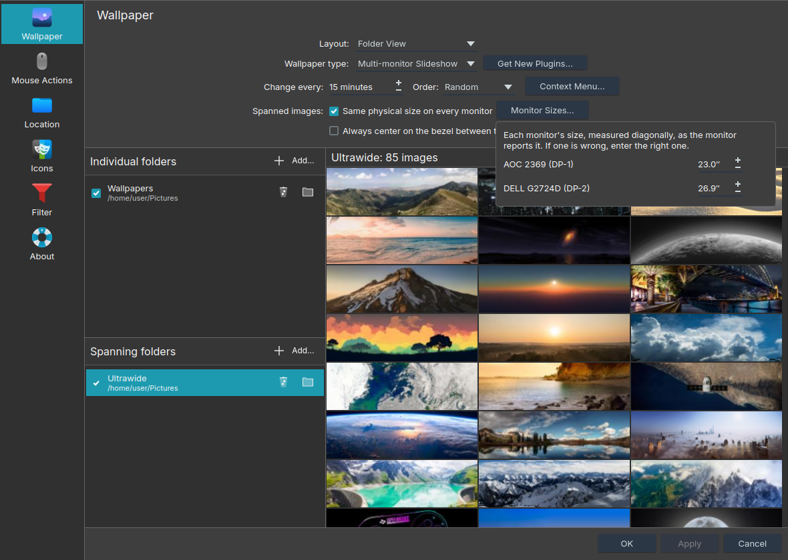

# Multi-monitor Slideshow



**Multi-monitor Slideshow** is a wallpaper slideshow for KDE Plasma 6 that
mixes normal wallpapers with spanning ones. Windows can rotate both kinds in
one slideshow; Plasma's built-in Slideshow can't. This plugin closes that
gap, with two kinds of images:

- **Spanned images** stretch across every monitor together, like the
  "Span" wallpaper mode on Windows. Use them for panoramas and for
  "dual monitor" or "triple monitor" wallpapers.
- **Individual images** are ordinary wallpapers. Each monitor shows a different
  one, like Plasma's built-in Slideshow.

Both kinds take turns in the same slideshow, and every monitor changes at
the same moment.

## Features

- **Any number of monitors, of any size.** Monitors can have different
  resolutions, sizes and heights. A spanned image is laid out over your
  monitors as they are arranged in Display Configuration. Mirrored monitors
  count as one and show the same part.
- **Same physical size on every monitor.** On monitors with different
  pixel sizes (say a 24" 1080p next to a 27" 1440p), a spanned image is
  scaled per monitor, so it keeps its real size and straight lines continue
  across the bezel. A monitor that reports a wrong size can be corrected.
- **Full-width wallpapers land on the right monitors.** A wallpaper as wide
  as all of your monitors together (such as 32:9 on two 16:9 monitors) is
  detected, and each monitor shows its own part, with the join on the
  bezel. Anything else is shown as one panorama.
- **Individual images fill the monitor your way:** scaled and cropped,
  scaled, scaled keeping proportions, centered or tiled, with a blurred
  copy of the image or a color where the image leaves the monitor free.
- **Slideshow order:** random, by name (A to Z, Z to A) or by date
  modified (newest or oldest first).
- **A settings page like the built-in Slideshow's:** folder lists with
  tickboxes, a thumbnail grid of each folder, and a tooltip on every
  setting.
- **Desktop right-click menu:** Open Image, Next, Next Individual and
  Next Spanned. Each entry can be hidden.
- **Settings are shared by all monitors.** Change them from any monitor.
- **Smooth crossfades** between images, and new images in your folders
  are picked up at the next change.

## Install

### From the KDE Store

1. Right-click the desktop and choose **Desktop and Wallpaper…**
2. Click **Get New Plugins…** and search for **Multi-monitor Slideshow**.
3. Click **Install**, then set it up as described in [Use](#use).

Its store page is
[https://store.kde.org/p/2375225](https://store.kde.org/p/2375225/).

### From a release archive

Download `multi-monitor-slideshow-<version>.tar.gz` from the
[releases page](https://github.com/VasilKalchev/plasma-multi-monitor-slideshow/releases) and
run:

```sh
kpackagetool6 -t Plasma/Wallpaper -i multi-monitor-slideshow-<version>.tar.gz
```

To update to a newer archive, use `-u` instead of `-i`.

### From source

```sh
git clone https://github.com/VasilKalchev/plasma-multi-monitor-slideshow.git
cd plasma-multi-monitor-slideshow
utils/deploy.sh
```

`utils/deploy.sh` copies the plugin into Plasma's wallpaper folder,
`~/.local/share/plasma/wallpapers/com.github.vasilkalchev.multimonitorslideshow/`,
and restarts Plasma. To update, run `git pull` and `utils/deploy.sh` again.

## Use

1. Right-click the desktop and choose **Desktop and Wallpaper…**
2. Set **Wallpaper type** to **Multi-monitor Slideshow**.
3. **Do this on every monitor.** Plasma keeps a separate wallpaper type
   for each monitor, and the dialog only changes the monitor you
   right-clicked. Right-click the desktop on each of the other monitors
   and set the wallpaper type there too. The plugin's settings are shared,
   so you only add folders and pick options once.
4. Add folders:
   - **Individual folders** for ordinary wallpapers, one per monitor.
   - **Spanning folders** for wide images that go across all monitors.

   Folders are read one level deep (subfolders are not included). JPEG,
   PNG, WebP and BMP images are used.
5. Choose how often the image changes and in which order, then click
   **Apply**.

If a spanned image shows on only one monitor, step 3 was missed: the
other monitors still have another wallpaper type.

### Settings


Click a folder to see its images. A spanning folder shows wide previews:



| Setting | What it does |
|---|---|
| **Change every** | How long each image stays up. |
| **Order** | **Random** shuffles all images, spanned and individual together. **A to Z**, **Z to A**, **Newest first** and **Oldest first** go through them by file name or date modified. On an individual turn, the monitors show the next images in line, left to right. |
| **Context Menu…** | Which entries the desktop's right-click menu shows. |
| **Same physical size on every monitor** | Scales spanned images per monitor, so they have the same real size on monitors with different pixel sizes, and lines continue straight across the bezel. |
| **Monitor Sizes…** | The size of each monitor, as it reports it. Correct a monitor that reports a wrong size here. |
| **Always center on the bezel between the monitors** | Off by default. Full-width images are always centered on the bezel; with this on, panoramas are too, instead of on your monitors as a whole. See below. |
| **Individual images** | How an individual image fills its monitor, like **Positioning** in the built-in Slideshow: **Scaled and Cropped** (the default) covers the monitor and cuts off what doesn't fit, **Scaled** stretches the image to the monitor's shape, **Scaled, Keep Proportions** shows the whole image, **Centered** shows it at its own size (smaller only if it's larger than the monitor), **Tiled** repeats it. |
| **Background** | For **Scaled, Keep Proportions** and **Centered**: what fills the part of the monitor the image leaves free, a blurred copy of the image or a color you pick. |

**Order** and **Context Menu…** open these lists:





The spanned-image settings are grayed out when they make no difference,
for example when your monitors are identical and lined up, and the reason
is shown below them.

Each folder has a tickbox: untick it to leave the folder out of the
slideshow without removing it. Click a folder to see its images on the
right, in the chosen order (shuffled for **Random**), and double-click an
image to open it. The folder button opens the
folder in your file manager.

### How spanned images are fitted

A spanned image is placed over your monitors as they sit in Display
Configuration, then cut to what each monitor covers. With **Same physical
size on every monitor** on, it is placed by the monitors' real sizes
instead of their pixel counts.

**Full-width images** are as wide as all of your monitors together. To
find them, the plugin cuts the image into one equal slice per monitor:
if a slice has the shape of every monitor (within 3%), the image is
full-width, and each slice goes to its own monitor. For example, a
5120×1440 image on two 16:9 monitors is two 2560×1440 slices, one per
monitor.

**Panoramas:** any other image is scaled, keeping its shape, until it
covers all monitors, and the overhang is cut evenly. It's centered on your
monitors as a whole, which cuts off the least. With **Always center on
the bezel between the monitors**, its middle goes on the bezel between the
two middle monitors (on the middle monitor's center with an odd count) and
on the middle of your largest monitor vertically. That keeps a two-part
image made for other monitors split on the bezel, such as two 16:10
halves on two 16:9 monitors, but more is cut off at the edges. With
identical monitors lined up side by side, both give the same result.

Some examples:

- **Two identical monitors:** a two-part wallpaper (for example 5120×1440
  for two 1440p monitors, or 3840×1080 for two 1080p ones) fits exactly. A
  wider image loses its left and right edges, a narrower one its top and
  bottom.
- **Monitors of different sizes:** with a full-width image, the largest
  monitor shows its slice in full. A smaller monitor next to it shows the
  part of its slice it physically covers, so it loses a bit of its outer
  edge and its top or bottom, never the edge at the join. Its vertical
  position in Display Configuration decides which: a monitor aligned to
  the top of the larger one shows the top of its slice.
- **Three or more monitors:** the same rules apply. A full-width image
  has to be as wide as that many monitors: a two-monitor wallpaper is too
  narrow for three, so it's shown as a panorama, and its join lands in the
  middle of the middle monitor. If the monitors differ in size, only the
  joins next to the largest monitor are sure to land on a bezel: two
  smaller monitors side by side are narrower than their two slices, so the
  join between those slices lands inside the outer one. On 24" + 24" + 27"
  1440p monitors, for example, the join between the two left parts lands
  240 px inside the leftmost monitor.
- **One monitor:** spanned images behave like individual ones.

To try your own monitors and images, open the
[interactive explanation](https://vasilkalchev.github.io/plasma-multi-monitor-slideshow/cropping.html).
[docs/cropping.md](docs/cropping.md) works through the math.

### Right-click menu

| Entry | What it does |
|---|---|
| **Open Image** | Opens the image on that monitor in your image viewer. |
| **Next** | Skips to the next image in the slideshow. |
| **Next Individual** | Skips ahead to the next turn of individual images. |
| **Next Spanned** | Skips ahead to the next spanned image. |

**Open Image** and **Next** are shown by default; the others can
be turned on in **Context Menu…**, together with a grayed-out "Wallpaper"
label above them.

## Limitations

- Spanning expects the monitors side by side in one row. They can have
  different heights and vertical positions, but monitors stacked above one
  another are not supported.
- With monitors of different shapes (say a 16:9 next to a 16:10, or a
  landscape next to a portrait one), no image is full-width: its slices
  would have to match every monitor. Every spanned image is then shown as
  a panorama.
- A gap left between two monitors in the display settings is kept for
  panoramas, but a full-width image ignores it: the monitor past the gap
  then has an empty strip as wide as the gap.
- Nothing is hidden behind the bezels: the image goes straight on from one
  monitor's edge to the next one's. Horizontal lines stay straight, but a
  slanted line looks shifted where it crosses a bezel.
- Settings changed while the slideshow runs take effect at the next image
  change. **Next** applies them right away.

## Troubleshooting

**Monitors jump, or desktops swap between monitors, when a TV turns on or
off.** KWin saves a separate monitor layout for every combination of
connected monitors, and a TV (especially behind an AV receiver) can show
up as several combinations while it powers on or off. If those saved
layouts disagree, the monitors move each time. To make them agree, arrange
your monitors, run [`utils/kwin-layout-keeper.py`](utils/kwin-layout-keeper.py),
switch the TV off and on, then stop the script with Ctrl+C. It re-applies
the layout you had when you started it, so KWin saves that layout for every
combination.

**A monitor shows the image at the wrong size.** The plugin uses the
physical size each monitor reports, and some report a wrong one (TVs
especially). Click **Monitor Sizes…** in the settings and enter the
monitor's real diagonal. An arrow appears next to a corrected size to go
back to the reported one.



**Checking the alignment.** Put
[`utils/span-test-5120x1440.png`](utils/span-test-5120x1440.png) in a
spanning folder of its own. On two 16:9 monitors it splits on the bezel:
its colored lines should continue straight across, and the squares and
circles marked 400 px should measure the same with a ruler on both
monitors.

**The desktop is black, or the slideshow doesn't change.** The plugin
writes what it finds to the journal: how many images are in how many
folders, a folder that wasn't found, an image that can't be loaded, and
the monitor layout it works with.

```sh
journalctl --user -u plasma-plasmashell.service | grep "Multi-monitor Slideshow"
```

A folder on a drive that isn't mounted yet is looked for again every 30
seconds while there are no images, and at every change otherwise.

## Uninstall

```sh
kpackagetool6 -t Plasma/Wallpaper -r com.github.vasilkalchev.multimonitorslideshow
```

This also removes a copy installed from source with `utils/deploy.sh`.
Thumbnails the plugin made are in
`~/.cache/com.github.vasilkalchev.multimonitorslideshow/`.

## More

- [Website](https://vasilkalchev.github.io/plasma-multi-monitor-slideshow/),
  with an interactive explanation of the cropping.
- [How it works](docs/how-it-works.md): how the plugin is built.
- [How cropping works](docs/cropping.md): the placement math, with a
  worked example.
- [Changelog](CHANGELOG.md): what changed in each version.
- [AGENTS.md](AGENTS.md): notes for working on the code.

## License

MIT. See [LICENSE](LICENSE).
